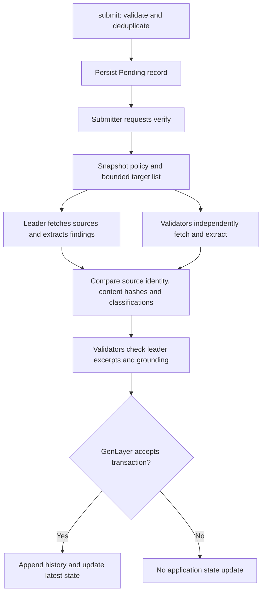

# Architecture

## Boundary and data model

EvidenceTrust is one portable Python contract file. Helpers use the deterministic standard library; web requests and model execution occur only inside the leader/validator nondeterministic execution. No frontend, server, RPC SDK or local file access is part of the contract.

Persistent fields use supported GenVM storage: `policy_json: str`, three `TreeMap[str, str]` collections and `DynArray[str]` for ordered record IDs. The runtime allocates collection fields. JSON strings are used as immutable storage snapshots, with bounded inputs, canonical key ordering and strict model-response schemas. Ordinary Python dict/list values exist only as transient values and ABI data.

- **Policy:** immutable constructor configuration, exact approved hosts, publisher groups, authority flags, fixed references, version and quorum thresholds. The version is human readable; the full canonical policy hash identifies its contents.
- **Record:** canonical claim, sorted source URLs, claimed observation time, transaction-context submission time, submitter, metadata, latest status and accepted-attempt count.
- **Fingerprint:** SHA-256 of the casefolded whitespace-normalized claim and canonical observation timestamp. This globally deduplicates the same claim/time despite changed submitters, metadata or URLs. It is not semantic similarity detection.
- **History:** record ID plus monotonically increasing revision keys. Each entry includes previous state, result, transaction-context verification time, requester, policy version/hash and per-source findings. History is append-only through the public API; original submission fields are immutable.

## Execution path

The source set is the sorted union of submitted URLs and all fixed reference endpoints. Each host must exactly match a policy entry. Six is the maximum union size, enforced at submission and again at verification. Fixed endpoints enable retrieval beyond user-selected URLs without inventing a web-search SDK or trusting arbitrary model-generated links.

Each leader source request returns either a UTF-8 document up to 48,000 bytes or an unavailable finding with a retrieval code. Oversized documents are rejected in full, never truncated into apparently sufficient evidence. Non-200 status, empty body, decoding errors and request exceptions have distinct audit codes. Model output is text parsed as strict JSON; malformed output aborts the attempt. Duplicate JSON keys, additional fields, invalid labels and non-verbatim quotes are rejected.

The model sees the exact claim, observation timestamp, source URL and source body. Metadata is excluded from evaluation. A source is classified as supports, contradicts, internally inconsistent or insufficient. Unsupported historical context must abstain. Only deterministic code can turn those classifications into application status.

## Equivalence principle

`gl.vm.run_nondet_unsafe(leader_fn, validator_fn)` supplies explicit custom validator logic:

1. Reject a leader exception or unexpected result shape.
2. Independently repeat every request and extraction using the same snapshotted inputs.
3. Require the same derived state and deterministic explanation.
4. Require the same ordered source identities, policy-controlled authority/group fields, retrieval classifications, evidence labels and content hashes, including value types.
5. For decision-bearing excerpts, require a bounded verbatim substring of the validator's independently retrieved document.
6. Independently assess the leader's selected excerpt in full document context. Require exactly a boolean grounded verdict.
7. Return false on uncertainty, malformed responses or exceptions.

This is substantive validation, not shape-only acceptance or a confidence-score tolerance. Model wording need not be identical: relevant alternative quotes can agree after grounding. Raw document hashes do match exactly. That deliberate safety choice can prevent consensus on changing HTML, personalization or changing API responses. Stable official text/JSON endpoints are preferred. An unchanged hash is not a cryptographic signature from the publisher.

The network handles committee selection, voting, retries and finality. The contract does not create validators or simulate their votes. Local direct mode executes the leader and allows separate calls of the captured validator function; those calls are not protocol consensus.

## Deterministic decision policy

Apply in this order:

1. Any internal inconsistency, or any observed supports/contradicts pair: **Disputed**. Even a configured non-authoritative source can raise a conflict, conservatively preventing an uncontested verdict.
2. Any unavailable or insufficient source: **Pending**.
3. At least `min_support` distinct authoritative publisher groups supporting: **Verified**.
4. At least `min_refute` distinct authoritative publisher groups contradicting: **Rejected**.
5. Otherwise: **Pending**.

Thresholds are immutable integers of at least two and cannot exceed configured authoritative group counts. Two URLs in the same publisher group count once. The model never chooses authority or group identifiers. All accepted rechecks can transition between any of the four states. A temporary outage can change Verified to Pending while preserving the earlier Verified entry.

## Invariants and bounds

- Malformed submissions write no records; a duplicated claim/time has one ID.
- Verification requires the submitter, an existing record and fewer than eight accepted attempts.
- Failed consensus or leader/model errors do not consume an application attempt.
- Every successful verification adds exactly one history entry and increments attempts once.
- Source set <= 6; claim <= 2,000 characters; URL <= 1,024; metadata JSON <= 4,000 with <= 16 bounded string entries; policy JSON <= 12,000; excerpt <= 600.
- Pagination is zero based and capped; records themselves have no global count cap.
- Public methods are nonpayable and make no external writes or value transfers.

No concurrency lock is invented: GenLayer transaction execution and state commitment determine ordering and atomicity. Contract application states remain distinct from pending/accepted/finalized transaction lifecycle states.

## Explicit scoped v2 mode

The preceding whole-claim policy remains v1 behavior. The opt-in `all_required_subclaims` mode adds submit_scoped and requires exact coverage of all configured authoritative fixed references, identified by unique source IDs. It generates a deterministic conjunction rather than accepting a free-text headline. Assessment and quote grounding use the designated subclaim; validators compare the complete source/subclaim identity as well as existing decision fields and document hashes. All required subclaims must support before Verified; mixed support/refutation is Disputed, missing evidence is Pending, and unanimous refutation requires the unchanged refutation threshold for Rejected. Conflict precedes missing evidence as in v1.

Scoped fingerprints include mode, policy hash, canonical mappings and observation time; scoped history includes mode and full mappings. V1 fingerprints and record/history shapes are preserved. No persistent storage fields or runner APIs change. The new ABI adds one nonpayable write method, for seven public methods total. See [SCOPED_V2.md](SCOPED_V2.md) for precise bounds, semantics and compatibility.
